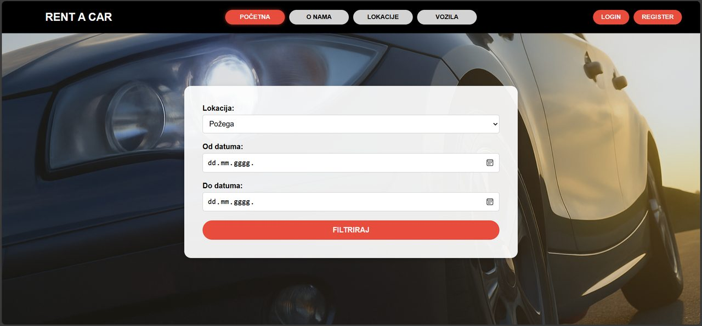
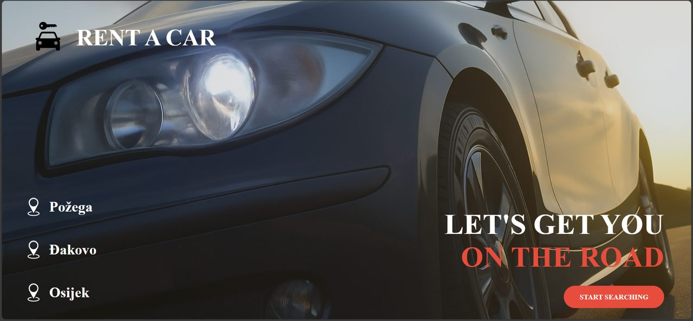
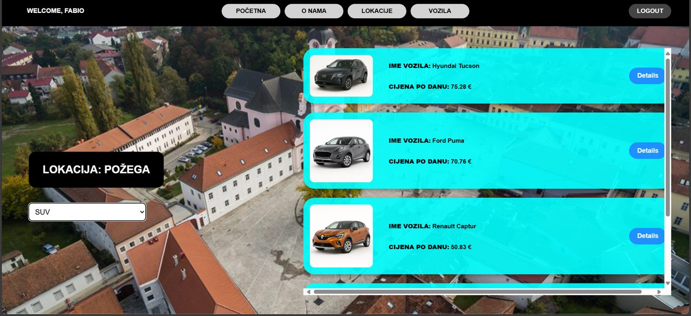
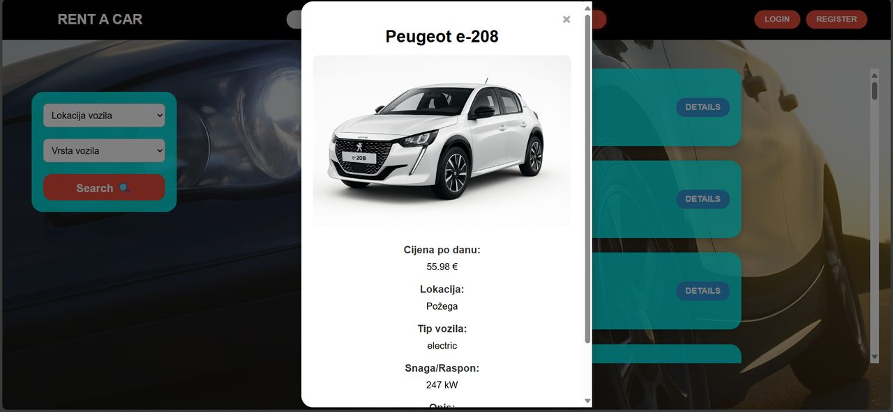
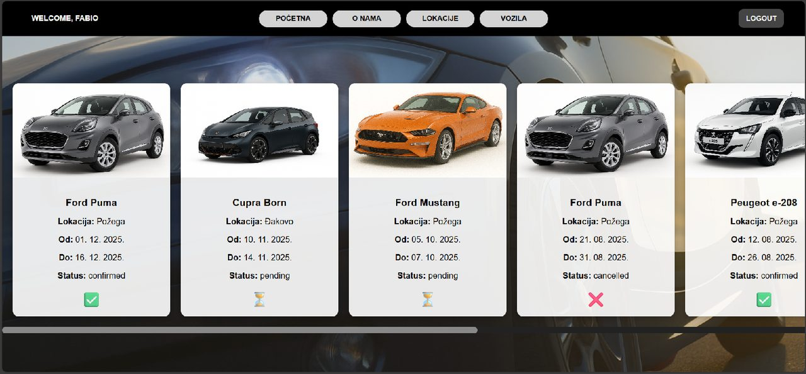
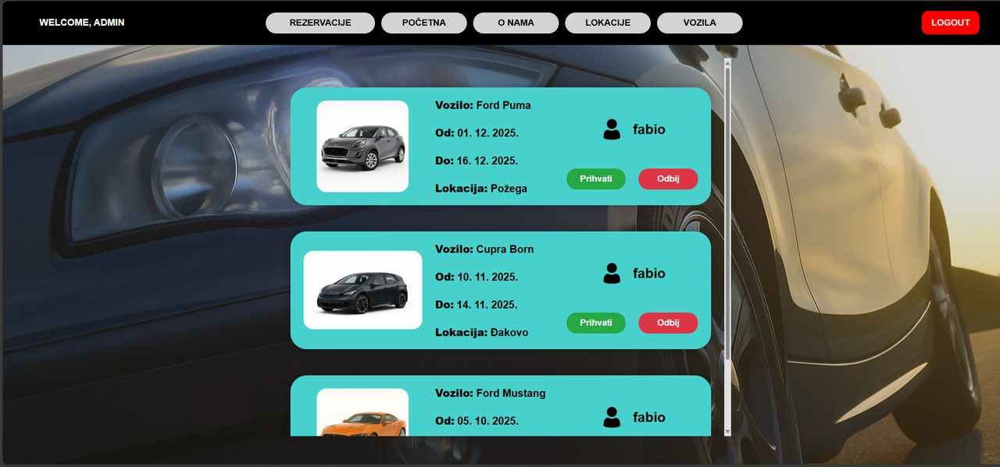

# Rent a Car – web application

A full-stack web application for renting vehicles across three locations in Croatia (Osijek, Požega, Đakovo). Users search for available vehicles by location and date, send reservation requests and track their status. An administrator manages the vehicle fleet and approves or rejects reservations.

Built as my bachelor's thesis at the Faculty of Electrical Engineering, Computer Science and Information Technology Osijek (FERIT).



## Features

**Visitors**
- browse all vehicles and filter them by location and vehicle type
- vehicle details (price per day, type, power/range, description)
- register and log in

**Registered users**
- search for vehicles that are free for a chosen location and date range
- send a reservation request and follow its status (pending, accepted, rejected)
- cancel a reservation
- save favourite vehicles

**Administrator**
- add new vehicles (with image upload) and delete existing ones
- review all reservation requests and accept or reject them
- overview of all accepted reservations

## Tech stack

| Layer | Technology |
| --- | --- |
| Frontend | HTML, CSS, vanilla JavaScript (Fetch API) |
| Backend | Node.js, Express |
| Database | MySQL (run locally with XAMPP / phpMyAdmin) |
| Libraries | `mysql2`, `bcrypt` (password hashing), `multer` (image upload), `cors` |
| Tools | Postman (API testing), Git, GitHub |

## Architecture

```
public/          frontend: HTML pages, styles, scripts, vehicle images
routes/          Express routes: /api/auth, /api/vehicles, /api/reservations
controllers/     request handling and SQL queries
middlewares/     route protection for administrator actions
config/db.js     MySQL connection pool
server.js        app entry point (port 3000)
```

The database `rent_a_car` contains four tables: `users`, `vehicles`, `reservations` and `favorites`.

## Screenshots

| | |
| --- | --- |
|  Landing page |  Available vehicles for a location and date |
|  Vehicle details |  User's reservations and their status |
|  Admin: reservation requests | |

## Running locally

Requirements: Node.js 18+ and MySQL (for example via [XAMPP](https://www.apachefriends.org/)).

```bash
git clone git@github.com:FabioMandic/Rent-a-car-webApp.git
cd Rent-a-car-webApp
npm install
```

1. Start MySQL (XAMPP Control Panel → MySQL → Start).
2. In phpMyAdmin create a database named `rent_a_car` with the tables `users`, `vehicles`, `reservations` and `favorites`.
3. Check the connection settings in `config/db.js`.
4. Start the server:

```bash
node server.js
```

Open http://localhost:3000.

## Roadmap

Planned improvements:

- [ ] SQL schema and seed script in the repository, so the database can be created with one command
- [ ] configuration through environment variables (`.env`) instead of values in code
- [ ] token-based authentication for protected routes
- [ ] automated API tests and CI
- [ ] Docker Compose setup (app + MySQL)

## Author

Fabio Mandić – FERIT Osijek
